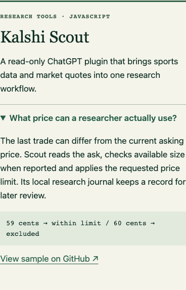

# Kalshi Scout · Quote filtering

A read-only ChatGPT plugin that brings sports data and market quotes into one research workflow.

## Engineering decision

The last trade can differ from the current asking price. Scout reads the ask, checks available size when reported and applies the requested price limit. Its local research journal keeps a record for later review.



## Run the standalone sample

Use Node.js 20 or newer from the repository directory. The sample uses the standard library and runs offline.

```sh
node demo.mjs
```

59 cents → within limit  /  60 cents → excluded

This repository contains the quote filtering component of the larger project. I developed the project with AI assistance.

[Portfolio](https://Egrocket1.github.io) · [GitHub profile](https://github.com/Egrocket1)
